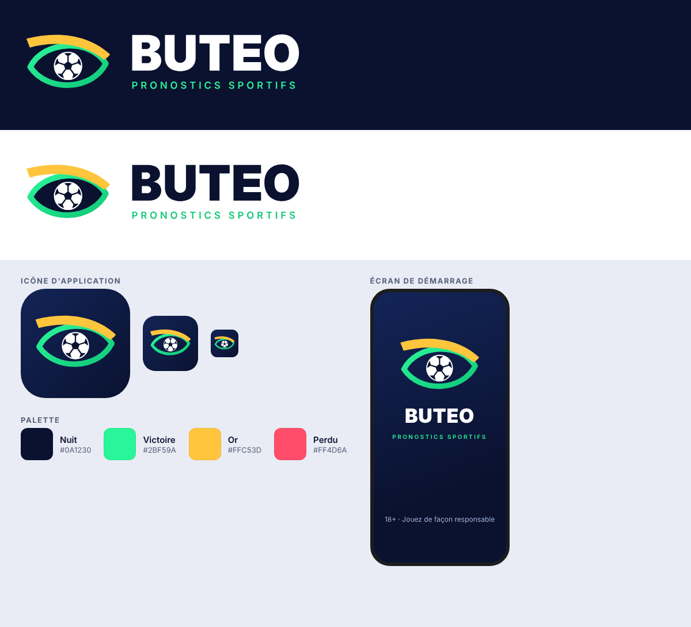

# Buteo — Pronostics sportifs

Application mobile de pronostics sportifs inspirée de *Multi Betting Tips*, en
version améliorée. **Statut : étape 4 sur 5 (paiements et publicité), en attente de ta
configuration Firebase, Google Play et AdMob pour passer en réel.**

## Décisions prises

- Vrai business, Android d'abord, en français, pour le monde francophone.
- Pronostics produits par une **IA**, publiés à **00:00**, avec un indice de confiance.
- Résultats mis à jour automatiquement, historique complet (gagnés et perdus).
- Revenus : coupon VIP à l'unité (500 FCFA), publicité dans la version gratuite,
  abonnements Pro (2 900 FCFA/mois) et Élite (6 900 FCFA/mois), aussi en 3 et 6 mois.
- Rubriques VIP : Score exact, Mi-temps / Fin, Combiné cote 5+, Combiné cote 10+,
  Simples VIP, Live. Le combiné cote 50+ de l'original est abandonné (trop rarement gagnant).
- Pas de liens vers les bookmakers.
- Paiement : Google Play dans l'app ; Mobile Money et crypto aussi (voir « Paiements »).
- Connexion par Google pour l'instant (le SMS demande le forfait payant de Firebase).
- En plus : équipes favorites, partage d'un prono sur WhatsApp, concours entre
  utilisateurs (sans gain d'argent), journal de paris. Pas d'essai gratuit ni de parrainage.

## Application (`app/`)

Application Flutter pour Android. Chaque envoi de code sur GitHub lance la
construction automatique de l'APK (`.github/workflows/buteo-android.yml`) :
analyse du code, tests, puis publication dans **Releases → « Buteo – version de test »**.

**Installer sur ton téléphone :** ouvre la page *Releases* du dépôt sur le
téléphone, télécharge `buteo-test.apk`, ouvre-le et autorise l'installation.
Les versions suivantes s'installent par-dessus.

Organisation du code :

| Dossier | Contenu |
|---|---|
| `lib/data/` | Rubriques, offres, pronos de démonstration, statistiques |
| `lib/state/` | Formule, coupons, favoris, compte, thème et alertes |
| `lib/services/` | Firebase : connexion, données du compte, notifications ; paiement Google Play, publicité AdMob |
| `lib/theme/` | Couleurs et polices de la marque |
| `lib/ui/screens/` | Accueil, rubrique, live, stats, offres, profil, démarrage |
| `lib/ui/widgets/` | Carte de prono, tuiles, badges, fenêtres d'achat |
| `test/` | Tests automatiques (générateur, états des matchs, compte, écrans) |
| `../firebase/` | Règles de sécurité de la base Firestore, fonctions serveur (vérification des achats) et leurs tests |
| `../engine/` | Moteur de pronostics en Python (voir son README) |

Commandes utiles (dans `app/`) : `flutter test`, `flutter analyze`,
`flutter build apk --release`, `dart run flutter_launcher_icons` (icône).

## Feuille de route

1. **Écrans et données de démonstration** (fait) : toute la maquette en Flutter,
   APK de test construit par GitHub.
2. **Comptes et notifications** (fait, à activer avec ta configuration Firebase) :
   connexion Google et téléphone, suppression du compte, équipes favorites
   synchronisées, alerte locale à 00:00 GMT, abonnement aux alertes serveur.
3. **Moteur de l'IA** (fait, à activer avec les clés) : modèle statistique,
   choix des pronos de football, publication chaque nuit, résultats toutes les
   10 minutes, statistiques, notification des résultats. L'app passe seule des
   données de démonstration aux vrais pronos dès la première publication.
4. **Paiements et publicité** (partie Google Play faite, à activer avec tes
   comptes) : abonnements et coupons Google Play vérifiés par le serveur,
   bannière AdMob dans la version gratuite. Reste le site web pour Mobile Money
   et crypto, une fois le prestataire choisi.
5. **Communauté et publication** : concours, journal de paris, back-office,
   test fermé puis mise en ligne sur le Play Store.

## Configurer Firebase (à faire une fois)

**Fait** : projet `buteo-bbec5`, configuration dans
`app/lib/services/firebase_config.dart`. Les étapes restent ci-dessous pour mémoire.

Sans cette configuration, l'app marche en mode local : favoris et alertes
restent sur le téléphone, et la connexion affiche un message d'attente.
Tout se fait depuis le navigateur du téléphone, sur
[console.firebase.google.com](https://console.firebase.google.com).

1. **Créer le projet** : « Créer un projet », nom `Buteo`. Google Analytics
   n'est pas nécessaire.
2. **Ajouter l'app Android** (icône Android) :
   - nom du package : `com.buteo.pronostics`
   - surnom : `Buteo`
   - empreinte SHA-1 : `73:45:D6:62:17:77:EC:97:81:47:EC:BA:CA:BA:A8:FC:57:58:CD:57`

   Passe les étapes « SDK » (déjà faites dans le code).
3. **Ajouter la seconde empreinte** : Paramètres du projet (roue dentée) →
   Vos applications → Buteo → « Ajouter une empreinte » :
   `71:18:B6:BB:F1:59:0C:12:77:EB:30:FF:64:24:04:69:E1:74:DC:E6:AC:AE:66:EC:43:B2:47:C2:26:6C:23:30`
4. **Connexion Google** : Authentication → Commencer → Méthode de connexion →
   Google → Activer, choisis ton adresse d'assistance, Enregistrer.
5. **Base de données** : Firestore Database → Créer une base de données →
   emplacement `europe-west1`, mode production. Puis onglet **Règles** :
   remplace tout par le contenu de [`firebase/firestore.rules`](firebase/firestore.rules)
   et touche **Publier**.
6. **Récupérer la configuration** : Paramètres du projet → Vos applications →
   Buteo → télécharge `google-services.json` (après l'étape 4, pour qu'il
   contienne l'identifiant Google). Envoie-moi son contenu : ce sont des
   identifiants publics, la sécurité repose sur les règles de l'étape 5.

**Connexion par SMS (payante)** : elle exige le forfait Blaze (carte
bancaire). Les 10 premiers SMS par jour sont gratuits, ensuite le prix dépend
du pays (de 0,01 à environ 0,46 $ par SMS). Pour l'activer : Mettre à niveau →
Blaze, fixe une **alerte de budget** (par exemple 5 €), puis Authentication →
Méthode de connexion → Téléphone → Activer. Pour tester sans payer, ajoute des
« numéros de téléphone de test » avec un code fixe dans le même écran.

## Activer les vrais pronos (étape 3)

Le moteur tourne gratuitement sur GitHub Actions. Il lui faut deux clés,
enregistrées comme **secrets** du dépôt (GitHub → Settings → Secrets and
variables → Actions → New repository secret) :

1. **`API_FOOTBALL_KEY`** : crée un compte sur
   [dashboard.api-football.com](https://dashboard.api-football.com) et prends
   l'offre **Pro** (environ 19 $ par mois). L'offre gratuite ne donne pas
   accès à la saison en cours. Copie la clé affichée dans le tableau de bord.
2. **`FIREBASE_SERVICE_ACCOUNT`** : console Firebase → Paramètres du projet →
   Comptes de service → « Générer une nouvelle clé privée ». Colle tout le
   contenu du fichier téléchargé. Cette clé est **secrète** : ne la partage
   avec personne et ne la mets jamais dans le code.
3. **Règles** : republie [`firebase/firestore.rules`](firebase/firestore.rules)
   dans la console (Firestore Database → Règles), elles couvrent maintenant
   les pronos.
4. **Fusionner dans `main`** : GitHub ne lance les tâches programmées que
   depuis la branche principale.

Pour un premier essai sans attendre la nuit : Actions → « Buteo – moteur de
pronostics » → Run workflow → tâche `publier`.

**Avant de vendre le VIP**, laisse tourner le moteur deux ou trois semaines :
les statistiques publiques montreront ses vrais résultats. Le modèle est testé
sur des données simulées, pas encore sur la vraie saison.

## Activer les paiements et la publicité (étape 4)

Sans cette configuration, l'app reste utilisable : un achat explique qu'il faut
passer par le Play Store, et la publicité affiche les annonces de test de Google.
Les étapes 1 et 2 se font une fois Firebase configuré (voir plus haut).

1. **Forfait Blaze** (carte bancaire) : console Firebase → Mettre à niveau →
   Blaze, puis fixe tout de suite une **alerte de budget** (par exemple 5 €).
   Avec peu d'utilisateurs, les fonctions de Buteo restent en général dans la
   part gratuite.
2. **Publier les fonctions et les règles** depuis GitHub, avec le secret
   `FIREBASE_SERVICE_ACCOUNT` de l'étape 3 :
   - Google Cloud ([console.cloud.google.com](https://console.cloud.google.com),
     même projet) → IAM et administration → IAM → ligne
     `firebase-adminsdk-…` → crayon → « Ajouter un autre rôle », sept fois :
     *Administrateur Cloud Functions*, *Utilisateur du compte de service*,
     *Administrateur Cloud Run*, *Administrateur Cloud Scheduler*,
     *Administrateur Artifact Registry*, *Administrateur Firebase Rules*,
     *Administrateur Service Usage*. Enregistrer.
   - GitHub → Actions → « Buteo – déploiement Firebase » → Run workflow →
     `tout`. (Ce bouton n'apparaît qu'une fois le code fusionné dans `main`.)
     Si une ligne rouge parle de permission, envoie-la-moi.
3. **Compte Google Play Console** (25 $, une seule fois) sur
   [play.google.com/console](https://play.google.com/console). En compte
   personnel, Google vérifie ton identité, puis exige un **test fermé de 12
   testeurs pendant 14 jours** avant la mise en ligne (étape 5).
   Dans Paramètres → **Profil de paiement**, vérifie que le Gabon est accepté
   pour vendre : sans profil de paiement, l'app peut être publiée mais pas
   vendre d'abonnements.
4. **Clé d'envoi** (sur ton PC Windows, une seule fois) : installe Java
   ([adoptium.net](https://adoptium.net)), puis dans PowerShell :

   ```
   keytool -genkeypair -v -keystore buteo-upload.jks -alias upload -keyalg RSA -keysize 2048 -validity 10000
   [Convert]::ToBase64String([IO.File]::ReadAllBytes("buteo-upload.jks")) | Set-Clipboard
   ```

   Ajoute deux secrets GitHub : `ANDROID_UPLOAD_KEYSTORE` (colle le texte
   copié) et `ANDROID_UPLOAD_PASSWORD` (le mot de passe choisi). Garde le
   fichier `.jks` et son mot de passe en lieu sûr, hors du dépôt. Chaque
   construction produit alors aussi `buteo-play-store` (Actions → la dernière
   exécution → Artifacts) : c'est le fichier `.aab` à envoyer sur Google Play.
5. **Première version sur Google Play** : crée l'app « Buteo », active la
   signature par Google Play, envoie le `.aab` en **test interne**. Puis, dans
   Intégrité de l'app → Signature, copie les empreintes SHA-1 et SHA-256 de la
   « clé de signature de l'app » et ajoute-les dans Firebase (comme à l'étape 3
   de la configuration Firebase) : sans elles, la connexion Google échoue dans
   la version du Play Store.
6. **Produits** (Monétiser avec Play), avec exactement ces identifiants :
   - abonnement `buteo_pro`, forfaits de base `mensuel` (1 mois, 2 900 FCFA),
     `trimestriel` (3 mois, 7 500 FCFA), `semestriel` (6 mois, 13 900 FCFA) ;
   - abonnement `buteo_elite`, mêmes forfaits (6 900, 17 900 et 32 900 FCFA) ;
   - produit intégré `coupon_vip` (500 FCFA).

   Forfaits en renouvellement automatique, sans essai gratuit. L'app affiche
   le prix local fixé par Google Play.
7. **Laisser le serveur vérifier les achats** :
   - Google Cloud → API et services → Bibliothèque → active **Google Play
     Android Developer API** ;
   - Play Console → Utilisateurs et autorisations → Inviter un utilisateur →
     `NUMÉRO-compute@developer.gserviceaccount.com` (le numéro du projet est
     dans les paramètres du projet Firebase), avec pour l'app Buteo les droits
     « Afficher les données financières » et « Gérer les commandes et les
     abonnements ». Google met parfois 24 heures à appliquer ces droits.
8. **AdMob** : crée un compte sur [admob.google.com](https://admob.google.com),
   ajoute l'app Android « Buteo », puis un bloc d'annonces **Bannière**.
   Envoie-moi l'identifiant de l'app (`ca-app-pub-…~…`) et celui du bloc
   (`ca-app-pub-…/…`) : ils sont publics, je les mets dans le code. Dans
   Confidentialité et messages, crée le message RGPD (pour les visiteurs
   européens). Ne clique jamais sur tes propres annonces. Google limite la
   publicité sur les contenus liés aux paris : attends-toi à un revenu
   publicitaire modeste, les abonnements restent la source principale.

Pour tester un achat sans payer : Play Console → Paramètres → Test de licence,
ajoute ton adresse Gmail, puis installe l'app depuis le lien du test interne.

## Paiements

Google Play impose son propre système de paiement pour les abonnements et les
achats numériques vendus **dans** une app installée depuis le Play Store. Ailleurs
qu'aux États-Unis, au Royaume-Uni, dans l'Espace économique européen et dans
quelques autres pays, l'ouverture aux paiements externes est annoncée au plus
tard pour septembre 2027.

Plan retenu :
- **Dans l'app** : Google Play Billing (abonnements Pro et Élite, coupons).
- **Sur le site web de Buteo** : Mobile Money et crypto. L'achat est
  rattaché au compte, et l'app débloque l'accès automatiquement à la
  connexion. Google interdit de mentionner ces moyens de paiement dans l'app.
- Dès que Google l'autorise dans un pays, ajout du lien vers le paiement
  externe directement dans l'app.

Prestataires pour un vendeur particulier au Gabon (à confirmer avec eux) :
- **FedaPay** ne liste pas le Gabon (Bénin, Côte d'Ivoire, Niger, Sénégal,
  Togo, Mali, Burkina Faso, Guinée).
- **Mobile Money au Gabon** : pawaPay (Airtel Money), ou les agrégateurs
  gabonais E-Billing, SingPay et PViT (Airtel Money et Moov Money).
- **Crypto** : NOWPayments (sans garde des fonds, frais d'environ 0,5 %).

## Maquette

`maquette/index.html` (validée) : ouvre-la dans un navigateur (sur téléphone de préférence).
Données fictives, heure simulée à 20:10 GMT. Lien direct vers une rubrique
avec `#id`, par exemple `index.html#score`.

## Le nom

**Buteo** est le nom latin de la buse, un rapace connu pour sa vue perçante.
On y entend aussi **« but »**. L'idée : un œil de rapace posé sur chaque match.

## Le logo



Un œil de rapace dont l'iris est un ballon. Le sourcil doré donne le regard
du prédateur et rappelle le trophée.

| Fichier | Usage |
|---|---|
| `marque/buteo-logo.svg` | Logo horizontal sur fond sombre |
| `marque/buteo-logo-clair.svg` | Logo horizontal sur fond clair |
| `marque/buteo-icone.svg` | Icône d'application (coins arrondis) |
| `marque/buteo-icone-carree.svg` | Icône carrée (Android adaptatif, stores) |
| `marque/buteo-icone-512.png` | Icône Google Play (512 × 512) |
| `marque/buteo-symbole.svg` | Symbole seul (écran de démarrage, favicon) |
| `marque/generer_logo.py` | Script qui régénère les SVG |

## Palette

| Nom | Couleur | Usage |
|---|---|---|
| Nuit | `#0A1230` | Fond principal |
| Victoire | `#2BF59A` | Pronostic gagné, actions principales |
| Or | `#FFC53D` | Offres VIP, mises en avant |
| Perdu | `#FF4D6A` | Pronostic perdu, alertes |

Polices : **Inter** pour le texte et **Barlow Condensed** pour les chiffres
(scores, cotes), toutes deux sous licence libre OFL.
